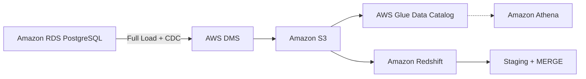

# AWS End-to-End Data Engineering Pipeline

## Project Overview

This project demonstrates an end-to-end data engineering pipeline on AWS, designed to replicate transactional data from PostgreSQL into analytical data systems.

### Business Problem

In a typical e-commerce application, PostgreSQL handles operational transactions such as customer orders and payments. Running complex analytical queries on the same database can compete with transactional workloads and affect application performance.

### Solution

The pipeline uses AWS Database Migration Service (DMS) for initial data loading and Change Data Capture (CDC). Transactional data is replicated to Amazon S3 and Amazon Redshift, while AWS Glue and Amazon Athena support data cataloging and SQL analytics.

The project also includes SQL performance benchmarking to examine the differences between transactional and analytical workloads.

## Architecture

For details, see [Architecture Documentation](architecture/README.md).

## Technology Stack

| Technology | Role in the Project |
|---|---|
| Amazon RDS (PostgreSQL) | OLTP source database for transactional data |
| AWS DMS | Full-load migration and Change Data Capture (CDC) |
| Amazon S3 | Raw data storage and data lake |
| AWS Glue | Data Catalog and metadata management |
| Amazon Athena | Serverless SQL analytics on S3 data |
| Amazon Redshift | OLAP data warehouse for analytical queries |
| SQL | Data transformation, incremental MERGE, and performance benchmarking |

## Data Pipeline Workflow

### 1. Transactional Data Source
Amazon RDS PostgreSQL serves as the OLTP source database, storing transactional records.

### 2. Initial Data Load
AWS DMS performs a full load to replicate existing PostgreSQL data into Amazon S3.

### 3. Change Data Capture (CDC)
AWS DMS captures ongoing INSERT, UPDATE, and DELETE operations from PostgreSQL and delivers change records to Amazon S3.

### 4. Data Lake and SQL Analytics
Amazon S3 stores replicated data. AWS Glue Data Catalog provides table metadata, allowing Amazon Athena to query the data using SQL.

### 5. Data Warehouse Loading
Data is loaded from Amazon S3 into Amazon Redshift staging tables.

### 6. Incremental Data Processing
SQL MERGE operations are used to apply incremental changes to target tables in Amazon Redshift. Correct handling of updates, deletes, and repeated CDC events requires validation.
